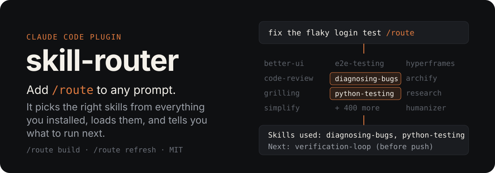
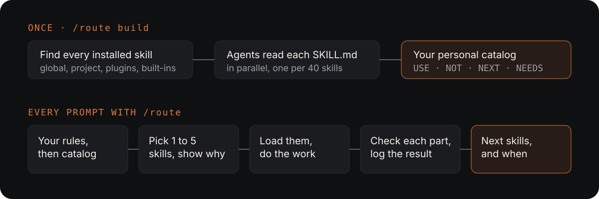

<p align="center">
  
</p>

Write your prompt as usual and add `/route`. The router reads the request, picks the best 1 to 5 of
your installed skills, shows which ones it loads and why, does the work with them, checks each part,
and ends with the skills worth running next.

```
/plugin marketplace add medjbilou/claude-skill-router
/plugin install skill-router@skill-router
/route build
```

## What it chose in real sessions

Picks from 18 headless test sessions on a machine with about 400 installed skills (edits, deploys and
messages were blocked during the tests). 18 of 18 matched the skills an experienced user would load by hand.

| You type | `/route` loaded |
|---|---|
| `Sentry keeps showing asyncpg TooManyConnectionsError… fix it /route` | `diagnosing-bugs`, then `caveman:surgical-patch` (after reading the runbook the project's CLAUDE.md requires) |
| `/route write tests first, then implement a phone-number normalizer, then review it` | `tdd`; end check marked each part, review suggested next |
| `I want a loyalty points system… help me think it through /route` | `grilling` |
| `/route compare Postgres job-queue libraries for our FastAPI app` | `search-first`, `postgres-patterns` |
| `draw me the architecture of the bot's message flow /route` | `graphify`, `archify` |
| `/route rename the variable chain to revision_chain` | none: "No skill needed" |
| `/route make it better` | none: asked which thing you meant, with options |
| `/route post today's deploys in #dev on Slack` | `slack:slack-messaging`; said Slack is not connected, drafted the message only |

The router also stays off when a prompt has no `/route`.

## Why

- **Claude Code can't show every skill.** Skill descriptions share a limited listing budget. Past it,
  the least-used skills show up by name only and are never picked automatically
  ([details](https://dev.to/rulestack/too-many-claude-code-skills-how-the-listing-budget-decides-which-descriptions-claude-sees-4a6m)).
- **Similar skills compete.** With five design skills installed, nothing tells Claude which one is
  right for this job, or which one needs an API key you don't have.
- **Hints get ignored.** A hook that suggested a skill on every prompt saw its suggestion used about
  5% of the time ([jev-skill-router](https://github.com/shimo4228/jev-skill-router)). `/route` is
  explicit: when you type it, the router loads the skills itself.

## How it works

<p align="center">
  
</p>

**Once:** `/route build` finds every skill you have (global, project, plugins, built-ins), writes a
short profile of your stack, and runs parallel agents that read each SKILL.md. Each skill gets one
catalog line: when to use it (USE), when not and what is better (NOT), what to run after it (NEXT),
and what it requires (NEEDS: a CLI, an API key, paid credits). The build tells you its size and waits
for your go.

**Every `/route`:** the router reads your own rules, then only the 1 to 3 catalog categories that
match the request. It loads the fewest skills that cover the whole request, never two that do the
same job, and asks first before any step that sends messages, deploys, deletes data, spends credits
or writes to production.

## Use

| You type | What happens |
|---|---|
| `fix the flaky login test /route` | Routes the whole message |
| `/route write the release notes` | Same, `/route` first |
| your prompt, then `/route` alone | Routes your previous message; only the work still left |
| `/route build` | Builds the catalog (first time, or to start over) |
| `/route refresh` | Adds new skills and drops removed ones after you change plugins |

Every reply starts with `Skills used: …` and ends with **Next skills**, each with a moment to run it
(now, before commit, before push, after deploy).

### Your own rules

Copy [`router.example.md`](router.example.md) to `~/.claude/router.md` (or set `ROUTE_OVERRIDES`):

```
- Polishing an existing UI screen -> better-ui (never impeccable unless I name it)
- Any production error or stack trace -> diagnosing-bugs
```

A matching rule beats the catalog's own picks.

### End check

When a request loads two or more skills or has several parts, the router checks each part before it
answers (done, partial or blocked, with a file:line or test result as evidence). A half-finished task
is reported as half-finished.

### Is it helping?

Each `/route` call adds one line to `~/.claude/route-catalog/usage.jsonl`, which stays on your machine.

```
python3 <plugin>/skills/route/scripts/inventory.py --report 30
```

```
/route calls: 42 in the last 30 days (6 with no skill needed)
skills loaded: 61; used by the work: 55; loaded but not needed: 6
end check: done 30, n/a 9, partial 3
Next skills followed within 48 h: 19/70 (27%)
often loaded but not needed (tighten their catalog line or add an override): humanizer 3
```

(Illustrative numbers.) "Followed" is measured from your real history: a suggested skill counts when
it was called within 48 hours.

## Details

- **Where things live.** The catalog, profile and log are in `~/.claude/route-catalog/` (set
  `ROUTE_CATALOG_DIR` to move them), never inside the plugin, so updates keep them. They describe your
  own setup: don't publish them.
- **Cost.** The build runs one agent per 40 skills. On a 400-skill setup that is about 10 agents and a
  few dollars of usage. Each `/route` call reads about 5k to 10k tokens of catalog.
- **Requirements.** Python 3 (standard library only). `ROUTE_INCLUDE=<regex>` limits the catalog to
  matching skill names.
- **Limits.** The router decides with the model you are running; it is as good as the catalog, so run
  `/route refresh` after installing skills, and `/route build` again after big changes.

```
skills/route/SKILL.md                the router
skills/route/BUILD.md                the one-time catalog build
skills/route/prompts/                prompts for the catalog and Default-picks agents
skills/route/scripts/inventory.py    finds skills, checks drift, assembles, indexes, logs, reports
```

## License

MIT
